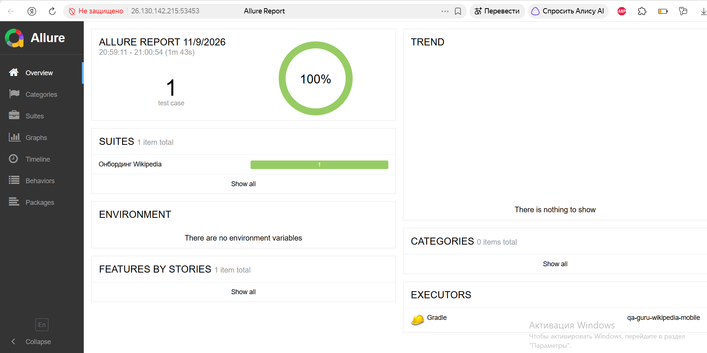
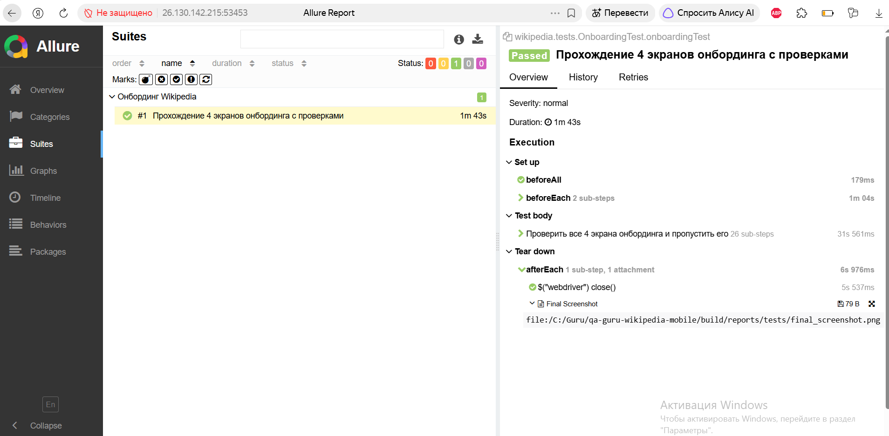

# Wikipedia Mobile Automation (Дипломный проект QA.GURU)

Мобильные автотесты для Android-приложения **Wikipedia** (Alpha версия).
Проект вынесен в отдельный независимый репозиторий в соответствии с требованиями к дипломной работе.

> **Основной проект (Web + API):**
> 🔗 [qa-guru-book-club-diploma](https://github.com/ESProshina/qa-guru-book-club-diploma)

## 🛠 Стек технологий
* **Java 21**
* **Selenide-Appium** (обертка над Appium для удобной работы)
* **Appium Java Client** (версия 9.x)
* **JUnit 5** (тестовый фреймворк)
* **Allure Report** (отчетность и вложения)
* **Gradle** (сборка проекта)
* **Owner** (управление конфигурациями)

## 🚀 Реализованные сценарии
В проекте реализовано **3 мобильных теста**, покрывающих базовые пользовательские пути (архитектура: **Screen Object Pattern**):

1. **Онбординг:** Прохождение 4 приветственных экранов и проверка открытия главного экрана.
2. **Поиск статьи (Java):** Ввод поискового запроса "Java", клик по первому результату и проверка заголовка статьи.
3. **Поиск статьи (Python):** Ввод поискового запроса "Python", клик по первому результату и проверка заголовка статьи.

## 💻 Запуск тестов локально
Так как мобильные тесты требуют наличия виртуального устройства, они запускаются локально на эмуляторе.

**Шаг 1. Подготовка окружения:**
1. Запустите эмулятор Android (например, через Android Studio) и убедитесь, что он виден по команде `adb devices`.
2. Запустите сервер Appium в отдельном терминале:
   ```bash
   appium

## 📸 Скриншоты

### 1. Успешное прохождение теста онбординга


## 🎥 Видеоотчет
В проекте настроена автоматическая запись экрана эмулятора. Видео прикрепляется к каждому тесту в Allure Report.


> **Примечание по тестам поиска:** Фреймворк содержит 3 теста (онбординг и 2 теста поиска). Тест онбординга успешно проходит в текущей среде. Тесты поиска требуют стабильного доступа к API Википедии (`en.wikipedia.org`), который ограничен настройками локального эмулятора и политиками безопасности текущей сети.